# Tarea 7

## Estimación, simulación y validación del movimiento browniano geométrico


``` r
set.seed(456)
library(quantmod)
```

```
## Warning: package 'quantmod' was built under R version 4.5.2
```

```
## Loading required package: xts
```

```
## Warning: package 'xts' was built under R version 4.5.2
```

```
## Loading required package: zoo
```

```
## Warning: package 'zoo' was built under R version 4.5.2
```

```
## 
## Attaching package: 'zoo'
```

```
## The following objects are masked from 'package:base':
## 
##     as.Date, as.Date.numeric
```

```
## Loading required package: TTR
```

```
## Registered S3 method overwritten by 'quantmod':
##   method            from
##   as.zoo.data.frame zoo
```

``` r
library(moments)
library(tseries)
```

```
## Warning: package 'tseries' was built under R version 4.5.2
```

# Problema 1. Datos reales y estimación de parámetros


``` r
ticker <- "GFNORTEO.MX"
getSymbols(ticker, src="yahoo", from="2015-01-01")
```

```
## Warning: GFNORTEO.MX contains missing values. Some functions will not work if
## objects contain missing values in the middle of the series. Consider using
## na.omit(), na.approx(), na.fill(), etc to remove or replace them.
```

```
## [1] "GFNORTEO.MX"
```

``` r
precio <- na.omit(Ad(get(ticker)))
```

## a)


``` r
log_precio <- log(precio)

plot(log_precio, main="Log Precio", col="blue")
```

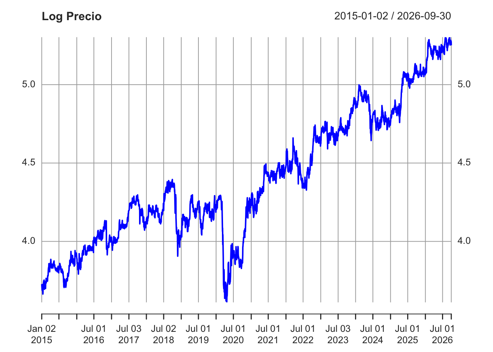

``` r
plot(precio, main="Precio", col="red")
```

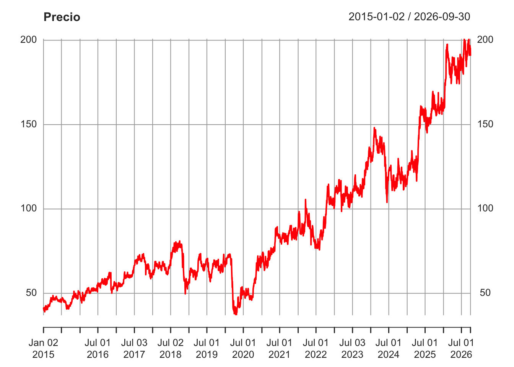

## b)


``` r
simple_rend <- dailyReturn(precio, type="arithmetic")
log_rend <- dailyReturn(precio, type="log")
head(cbind(simple_rend, log_rend, log_precio))
```

```
##            daily.returns daily.returns.1 GFNORTEO.MX.Adjusted
## 2015-01-02   0.000000000     0.000000000             3.727426
## 2015-01-05  -0.028288717    -0.028696553             3.698730
## 2015-01-06  -0.009660650    -0.009707616             3.689022
## 2015-01-07   0.021619003     0.021388627             3.710411
## 2015-01-08   0.015096539     0.014983720             3.725394
## 2015-01-09  -0.008516767    -0.008553242             3.716841
```

## c)


``` r
r <- mean(log_rend)
R <- mean(simple_rend)
sigma_log <- sd(log_rend)
mean_log <- r
sigma_log
```

```
## [1] 0.0204431
```

``` r
mean_log
```

```
## [1] 0.0005159287
```

## d)


``` r
dias_cot <- 252
sigma_anual <- sigma_log*sqrt(dias_cot)
sigma_anual
```

```
## [1] 0.3245242
```

``` r
sigma_log
```

```
## [1] 0.0204431
```

## e)


``` r
mu_log_anual <-dias_cot*mean_log
mu_log_anual
```

```
## [1] 0.130014
```

``` r
mu_gbm_anual <- mu_log_anual+0.5*sigma_anual^2
mu_gbm_anual
```

```
## [1] 0.182672
```

## f)

Porque 252 por la media diaria me da el rendimiento anual del log del precio pero no directamente el mu del GBM. Para sacar el mu se tiene que regresar el ajuste de la volatilidad y sumarle 0.5*sigma^2.

## g)


``` r
So <- as.numeric(last(precio))
mu <- mu_gbm_anual
sigma <- sigma_anual
So
```

```
## [1] 190.75
```

``` r
mu
```

```
## [1] 0.182672
```

``` r
sigma
```

```
## [1] 0.3245242
```


``` r
tabla_p1 <- data.frame(
  So=So,
  r_daily=mean_log,
  sigma_daily=sigma_log,
  sigma_ann=sigma_anual,
  mu=mu_gbm_anual
)

tabla_p1
```

```
##       So      r_daily sigma_daily sigma_ann       mu
## 1 190.75 0.0005159287   0.0204431 0.3245242 0.182672
```

# Problema 2. Diagnóstico distribucional

## a), b) y c)


``` r
hist(precio, n=100, main="Histograma del precio", col="green")
```

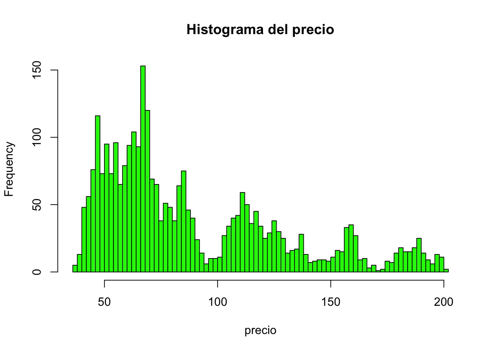

``` r
hist(log_precio, n=100, main="Histograma del log precio", col="blue")
```

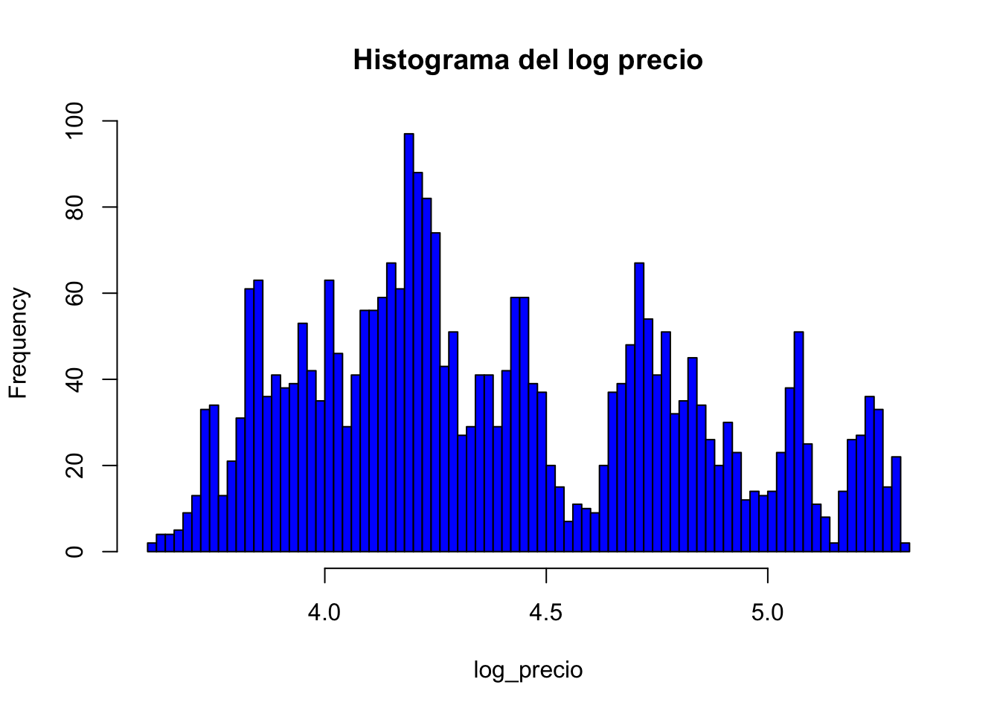

``` r
hist(simple_rend, n=100, main="Histograma del rendimiento simple", col="orange")
```

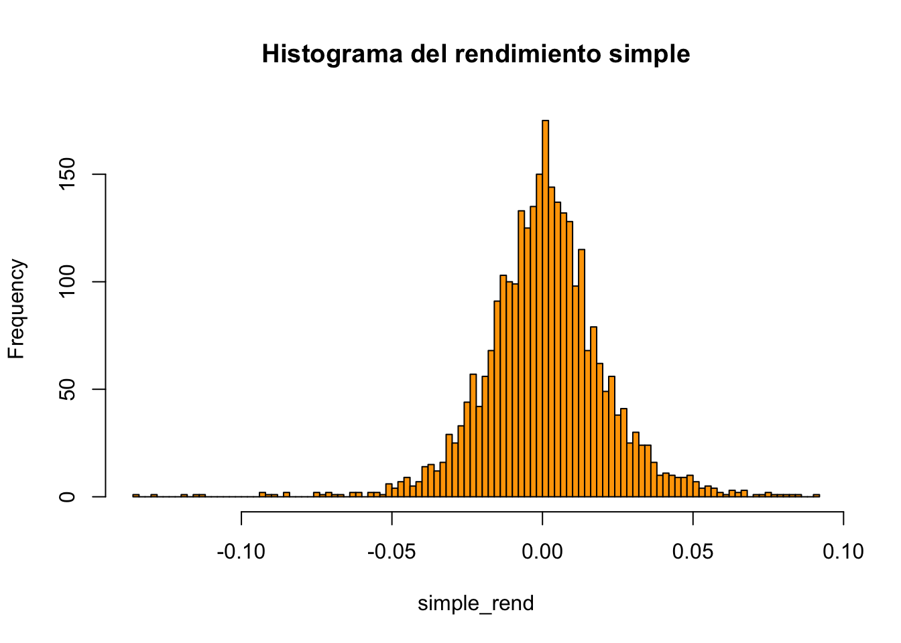

``` r
hist(log_rend, n=100, main="Histograma del Rendimiento", col="pink")
```

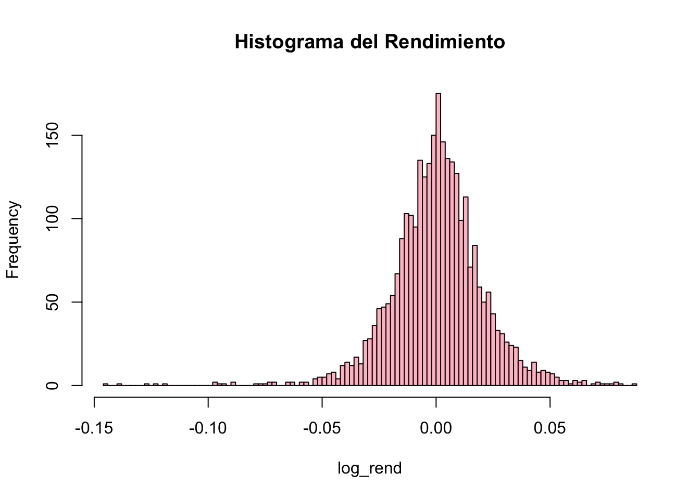

## d)


``` r
jb_precio <- jarque.bera.test(precio)
jb_log_precio <- jarque.bera.test(log_precio)
jb_simple <- jarque.bera.test(simple_rend)
jb_log <- jarque.bera.test(log_rend)

jb_precio
```

```
## 
## 	Jarque Bera Test
## 
## data:  precio
## X-squared = 494.82, df = 2, p-value < 2.2e-16
```

``` r
jb_log_precio
```

```
## 
## 	Jarque Bera Test
## 
## data:  log_precio
## X-squared = 166.25, df = 2, p-value < 2.2e-16
```

``` r
jb_simple
```

```
## 
## 	Jarque Bera Test
## 
## data:  simple_rend
## X-squared = 1795.2, df = 2, p-value < 2.2e-16
```

``` r
jb_log
```

```
## 
## 	Jarque Bera Test
## 
## data:  log_rend
## X-squared = 2498.8, df = 2, p-value < 2.2e-16
```

## e)


``` r
tabla_p2 <- data.frame(
  Variable=c("Precio","Log precio","Rendimiento simple","Log rendimiento"),
  Estadistico=c(as.numeric(jb_precio$statistic),
                as.numeric(jb_log_precio$statistic),
                as.numeric(jb_simple$statistic),
                as.numeric(jb_log$statistic)),
  P_value=c(jb_precio$p.value,
            jb_log_precio$p.value,
            jb_simple$p.value,
            jb_log$p.value),
  Rechazar_H0=c(jb_precio$p.value<.05,
                jb_log_precio$p.value<.05,
                jb_simple$p.value<.05,
                jb_log$p.value<.05)
)

tabla_p2
```

```
##             Variable Estadistico P_value Rechazar_H0
## 1             Precio    494.8187       0        TRUE
## 2         Log precio    166.2534       0        TRUE
## 3 Rendimiento simple   1795.1745       0        TRUE
## 4    Log rendimiento   2498.7716       0        TRUE
```

TRUE significa que rechazo H0 de normalidad y FALSE que no la rechazo

## f)

La prueba que esta mas relacionasa con el supuesto del GBM es la de los log-rendimientos porque bajo GBM los cambios del log del precio son los que se modelan como normales.

## g)

Probar normalidad sobre todos los log precios juntos se tiene que tomar con cuidado porque el precio va cambiando con el tiempo y no son observaciones con la misma media durante toda la historia.

## h)

En los datos reales los rendimientos pueden tener colas mas pesadas, sesgo y periodos donde la volatilidad se concentra. Entonces aunque el GBM nos sirve como modelo los datos reales no necesariamente se ven perfectamente normales

# Problema 3. Probabilidad teórica y empírica a corto plazo


``` r
dt_5d <- 5/dias_cot
```

## a) Aproximación local teórica


``` r
mean_ds_5 <- mu*So*dt_5d
sd_ds_5 <- sigma*So*sqrt(dt_5d)

zo_ds_5 <- (0-mean_ds_5)/sd_ds_5
prob_ds_teo_5 <- pnorm(zo_ds_5, mean=0, sd=1)

prob_ds_teo_5
```

```
## [1] 0.4684016
```

## b) Aproximación local empírica


``` r
z <- rnorm(100000, mean = 0, sd=1)
dSt_5 <- mu*So*dt_5d+sigma*So*sqrt(dt_5d)*z

prob_ds_emp_5 <- mean(dSt_5<0)
prob_ds_emp_5
```

```
## [1] 0.46799
```

## c) Solución exacta teórica


``` r
e_lnS_5 <- log(So)+(mu-.5*sigma^2)*dt_5d
ds_lnS_5 <- sigma*sqrt(dt_5d)

zo_5 <- (log(So)-e_lnS_5)/ds_lnS_5
prob_exacta_teo_5 <- pnorm(zo_5, mean=0, sd=1)

prob_exacta_teo_5
```

```
## [1] 0.4774987
```

## d) Solución exacta empírica


``` r
St_5d <- So*exp((mu-.5*sigma^2)*dt_5d+sigma*sqrt(dt_5d)*z)

prob_exacta_emp_5 <- mean(St_5d<So)
prob_exacta_emp_5
```

```
## [1] 0.47662
```

## e)


``` r
tabla_p3 <- data.frame(
  Metodo=c("dS teorico","dS empirico","Exacta teorico","Exacta empirico"),
  Probabilidad=c(prob_ds_teo_5,
                 prob_ds_emp_5,
                 prob_exacta_teo_5,
                 prob_exacta_emp_5)
)

tabla_p3
```

```
##            Metodo Probabilidad
## 1      dS teorico    0.4684016
## 2     dS empirico    0.4679900
## 3  Exacta teorico    0.4774987
## 4 Exacta empirico    0.4766200
```

## f)

A 5 dias espero que los resultados sean parecidos porque es un periodo corto y la aproximacion local todavia no se aleja tanto de la solucion exacta.

# Problema 4. La misma probabilidad a un año


``` r
dt_1anio <- 1
```

## a) Aproximación local teórica


``` r
mean_ds_1a <- mu*So*dt_1anio
sd_ds_1a <- sigma*So*sqrt(dt_1anio)

zo_ds_1a <- (0-mean_ds_1a)/sd_ds_1a
prob_ds_teo_1a <- pnorm(zo_ds_1a, mean=0, sd=1)

prob_ds_teo_1a
```

```
## [1] 0.2867543
```

## b) Aproximación local empírica


``` r
z <- rnorm(100000, mean = 0, sd=1)
dSt_1a <- mu*So*dt_1anio+sigma*So*sqrt(dt_1anio)*z

prob_ds_emp_1a <- mean(dSt_1a<0)
prob_ds_emp_1a
```

```
## [1] 0.28761
```

## c) Solución exacta teórica


``` r
e_lnS_1a <- log(So)+(mu-.5*sigma^2)*dt_1anio
ds_lnS_1a <- sigma*sqrt(dt_1anio)

zo_1a <- (log(So)-e_lnS_1a)/ds_lnS_1a
prob_exacta_teo_1a <- pnorm(zo_1a, mean=0, sd=1)

prob_exacta_teo_1a
```

```
## [1] 0.3443464
```

## d) Solución exacta empírica


``` r
St_1anio <- So*exp((mu-.5*sigma^2)*dt_1anio+sigma*sqrt(dt_1anio)*z)

prob_exacta_emp_1a <- mean(St_1anio<So)
prob_exacta_emp_1a
```

```
## [1] 0.34474
```

## e)


``` r
tabla_p4 <- data.frame(
  Horizonte=c("5 dias","5 dias","5 dias","5 dias","1 año","1 año","1 año","1 año"),
  Metodo=c("dS teorico","dS empirico","Exacta teorico","Exacta empirico",
           "dS teorico","dS empirico","Exacta teorico","Exacta empirico"),
  Probabilidad=c(prob_ds_teo_5,
                 prob_ds_emp_5,
                 prob_exacta_teo_5,
                 prob_exacta_emp_5,
                 prob_ds_teo_1a,
                 prob_ds_emp_1a,
                 prob_exacta_teo_1a,
                 prob_exacta_emp_1a)
)

tabla_p4
```

```
##   Horizonte          Metodo Probabilidad
## 1    5 dias      dS teorico    0.4684016
## 2    5 dias     dS empirico    0.4679900
## 3    5 dias  Exacta teorico    0.4774987
## 4    5 dias Exacta empirico    0.4766200
## 5     1 año      dS teorico    0.2867543
## 6     1 año     dS empirico    0.2876100
## 7     1 año  Exacta teorico    0.3443464
## 8     1 año Exacta empirico    0.3447400
```

## f)

La aproximacion con dS es la que se deteriora mas cuando aumenta el tiempo porque es una aproximacion local. La solucion exacta ya toma en cuenta la forma exponencial del GBM

# Problema 5. Precios futuros e intervalos de probabilidad


``` r
T <- c(1/252,10/252,60/252,1)

precio_esperado <- So*exp(mu*T)
varianza <- So^2*exp(2*mu*T)*(exp(sigma^2*T)-1)
mediana <- So*exp((mu-.5*sigma^2)*T)

z_nc <- qnorm(1-(1-.95)/2)

inferior <- So*exp((mu-.5*sigma^2)*T-z_nc*sigma*sqrt(T))
superior <- So*exp((mu-.5*sigma^2)*T+z_nc*sigma*sqrt(T))

e_lnS <- log(So)+(mu-.5*sigma^2)*T
ds_lnS <- sigma*sqrt(T)
zo <- (log(1.10*So)-e_lnS)/ds_lnS
prob_mas_10 <- pnorm(zo, mean=0, sd=1, lower.tail = FALSE)
```


``` r
tabla_p5 <- data.frame(
  T=T,
  Precio_Esperado=precio_esperado,
  Varianza=varianza,
  Mediana=mediana,
  Inferior_95=inferior,
  Superior_95=superior,
  Prob_Mas_10=prob_mas_10
)

tabla_p5
```

```
##             T Precio_Esperado   Varianza  Mediana Inferior_95 Superior_95
## 1 0.003968254        190.8883   15.23152 190.8484    183.3527    198.6506
## 2 0.039682540        192.1377  154.60621 191.7367    168.9187    217.6369
## 3 0.238095238        199.2294 1007.87876 196.7471    144.2512    268.3475
## 4 1.000000000        228.9802 5823.17735 217.2346    114.9988    410.3595
##    Prob_Mas_10
## 1 1.767690e-06
## 2 8.158108e-02
## 3 3.422235e-01
## 4 5.425808e-01
```

Conforme aumenta T el intervalo se hace mas amplio y hay mas incertidumbre sobre el precio que puede tener el activo.

# Problema 6. Verificación Monte Carlo de los momentos


``` r
T <- 1
z <- rnorm(100000, mean = 0, sd=1)

St_1anio <- So*exp((mu-.5*sigma^2)*T+sigma*sqrt(T)*z)
```

## a), b) y c)


``` r
media_teo <- So*exp(mu)
varianza_teo <- So^2*exp(2*mu)*(exp(sigma^2)-1)
media_emp <- mean(St_1anio)
varianza_emp <- var(St_1anio)

rbind(Simulado=c(Media=media_emp,
                 Varianza=varianza_emp),
      Teorico=c(Media=media_teo,
                Varianza=varianza_teo))
```

```
##             Media Varianza
## Simulado 229.0527 5792.582
## Teorico  228.9802 5823.177
```

## d)


``` r
z_nc <- qnorm(1-(1-.95)/2)

inferior <- So*exp((mu-.5*sigma^2)*T-z_nc*sigma*sqrt(T))
superior <- So*exp((mu-.5*sigma^2)*T+z_nc*sigma*sqrt(T))

porcentaje_ic <- mean(St_1anio>inferior & St_1anio<superior)*100
porcentaje_ic
```

```
## [1] 95.112
```

## e)

No espero que salga exactamente igual porque la simulacion tiene error de montecarlo. Entre mas simulaciones haga normalmente se va acercando mas a lo teorico.

# Problema 7. Normalidad bajo el modelo

## a)


``` r
hist(St_1anio, n=100, main="Precio simulado")
```

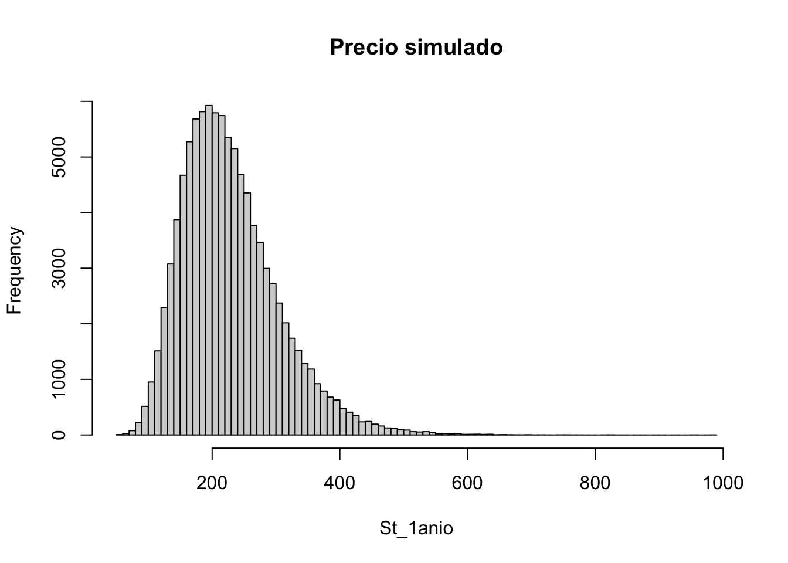

``` r
jarque.bera.test(St_1anio)
```

```
## 
## 	Jarque Bera Test
## 
## data:  St_1anio
## X-squared = 34334, df = 2, p-value < 2.2e-16
```

## b)


``` r
YT <- log(St_1anio)

hist(YT, n=100, main="Log del precio simulado")
```

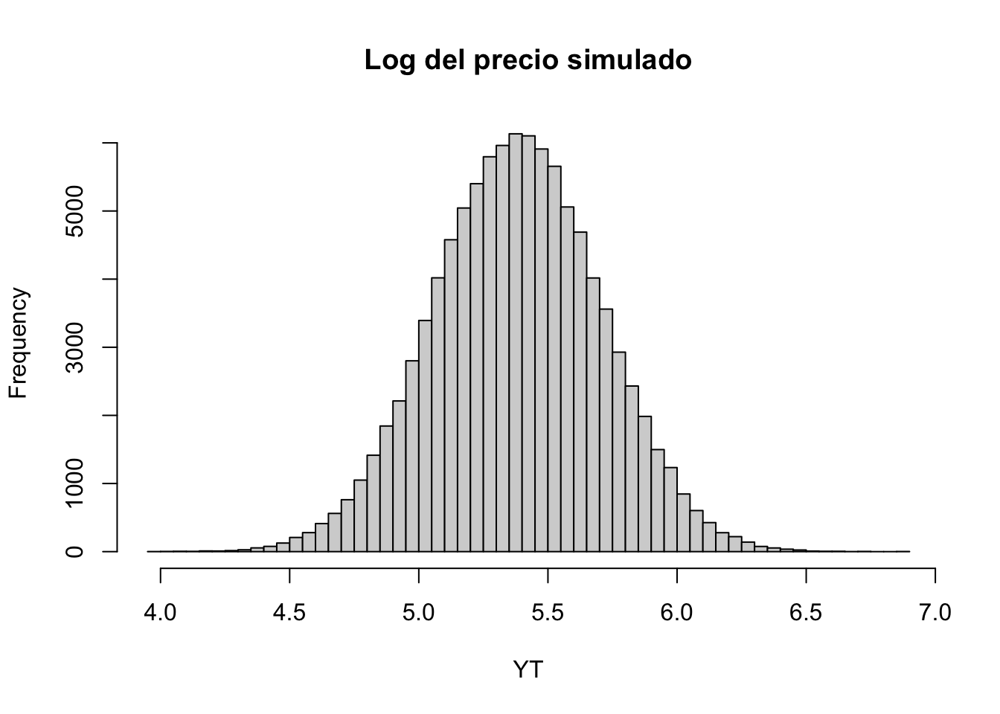

``` r
jarque.bera.test(YT)
```

```
## 
## 	Jarque Bera Test
## 
## data:  YT
## X-squared = 1.1504, df = 2, p-value = 0.5626
```

## c)


``` r
r_0T <- log(St_1anio/So)

hist(r_0T, n=100, main="Log rendimiento simulado")
```

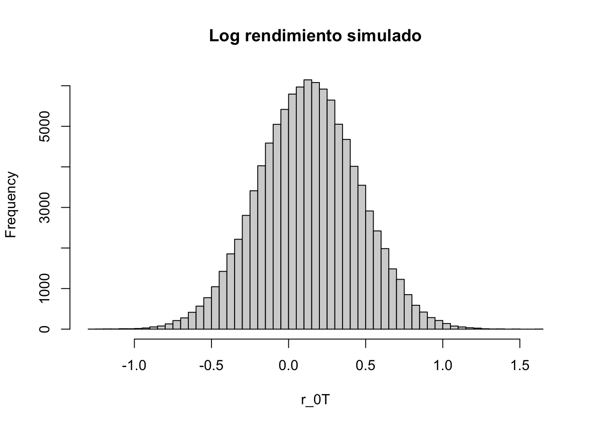

``` r
jarque.bera.test(r_0T)
```

```
## 
## 	Jarque Bera Test
## 
## data:  r_0T
## X-squared = 1.1504, df = 2, p-value = 0.5626
```

## d)

Bajo GBM el log del precio y el log rendimiento son los que deberian comportarse como una Normal.

## e)

El precio St deberia comportarse como lognormal.

## f)

En las simulaciones el modelo genera justo las distribuciones que supone el GBM pero en los datos reales las pruebas pueden rechazar normalidad. Eso muestra que el modelo simplifica cosas que si pasan en el mercado real.

# Problema 8. Euler-Maruyama vs solución exacta

## Paso diario: dt = 1/252


``` r
set.seed(456)
z2 <- rnorm(252)
n_dias <- 252
dt <- 1/n_dias
S_exacta <-numeric(n_dias+1) 
S_apro <- numeric(n_dias+1)
S_exacta[1] <- So
S_apro[1] <- So
for (i in 1:n_dias) {
  S_exacta[i+1] <- S_exacta[i]*exp((mu-.5*sigma^2)*dt+sigma*sqrt(dt)*z2[i])
  S_apro[i+1] <- S_apro[i]+S_apro[i]*mu*dt+sigma*S_apro[i]*sqrt(dt)*z2[i]
}
```


``` r
matplot(cbind(S_apro, S_exacta), type="l", xlab="Dias de cotización", ylab="Precio", 
        main="Sol Exacta vs Aproximación")
```

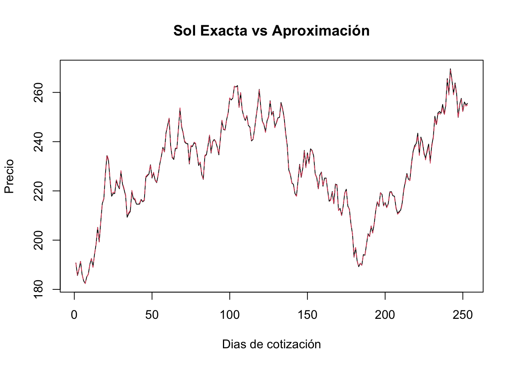


``` r
error_252 <- sqrt((S_apro[n_dias+1]-S_exacta[n_dias+1])^2)
error_252
```

```
## [1] 0.5910419
```

## Paso semanal: dt = 1/52


``` r
set.seed(456)
z2 <- rnorm(52)
n_dias <- 52
dt <- 1/n_dias
S_exacta <-numeric(n_dias+1) 
S_apro <- numeric(n_dias+1)
S_exacta[1] <- So
S_apro[1] <- So
for (i in 1:n_dias) {
  S_exacta[i+1] <- S_exacta[i]*exp((mu-.5*sigma^2)*dt+sigma*sqrt(dt)*z2[i])
  S_apro[i+1] <- S_apro[i]+S_apro[i]*mu*dt+sigma*S_apro[i]*sqrt(dt)*z2[i]
}
```


``` r
matplot(cbind(S_apro, S_exacta), type="l", xlab="Semanas", ylab="Precio", 
        main="Sol Exacta vs Aproximación")
```

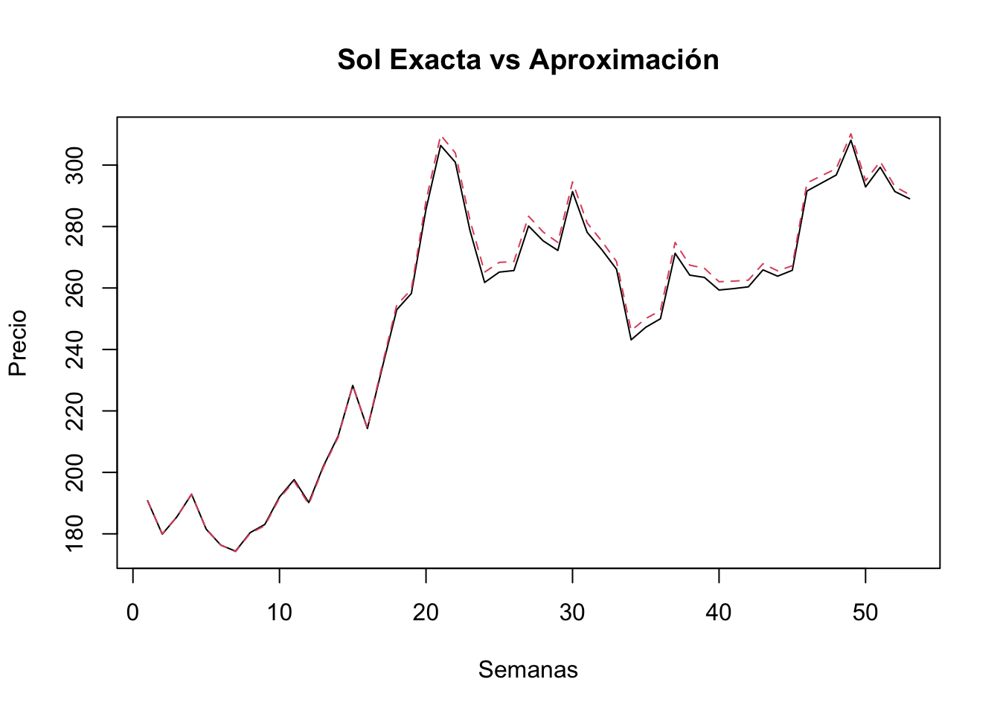


``` r
error_52 <- sqrt((S_apro[n_dias+1]-S_exacta[n_dias+1])^2)
error_52
```

```
## [1] 1.318849
```

## Paso mensual: dt = 1/12


``` r
set.seed(456)
z2 <- rnorm(12)
n_dias <- 12
dt <- 1/n_dias
S_exacta <-numeric(n_dias+1) 
S_apro <- numeric(n_dias+1)
S_exacta[1] <- So
S_apro[1] <- So
for (i in 1:n_dias) {
  S_exacta[i+1] <- S_exacta[i]*exp((mu-.5*sigma^2)*dt+sigma*sqrt(dt)*z2[i])
  S_apro[i+1] <- S_apro[i]+S_apro[i]*mu*dt+sigma*S_apro[i]*sqrt(dt)*z2[i]
}
```


``` r
matplot(cbind(S_apro, S_exacta), type="l", xlab="Meses", ylab="Precio", 
        main="Sol Exacta vs Aproximación")
```

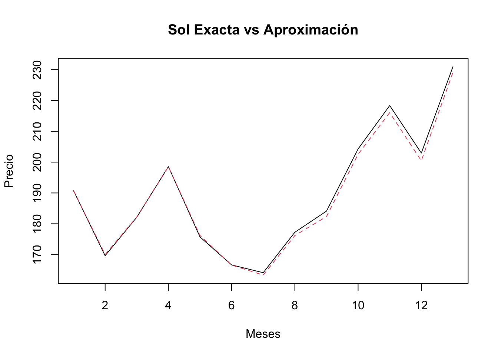


``` r
error_12 <- sqrt((S_apro[n_dias+1]-S_exacta[n_dias+1])^2)
error_12
```

```
## [1] 1.838579
```


``` r
tabla_p8 <- data.frame(
  Paso=c("1/252","1/52","1/12"),
  Error=c(error_252,error_52,error_12)
)

tabla_p8
```

```
##    Paso     Error
## 1 1/252 0.5910419
## 2  1/52 1.3188491
## 3  1/12 1.8385788
```

## f)

En general cuando el paso es mas grande la aproximacion puede alejarse mas de la exacta porque estamos haciendo menos ajustes durante el año.

## g)

La solucion exacta siempre da precios positivos porque usa una exponencial. Euler no necesariamente porque suma cambios al precio y con un shock suficientemente negativo puede cruzar cero.

# Problema 9. Horizonte temporal y probabilidad


``` r
So <- 15
mu <- .15
sigma <- .65
```

## a) y b)

### Un mes


``` r
T_1mes <- 1/12

e_lnS <- log(So)+(mu-.5*sigma^2)*T_1mes
ds_lnS <- sigma*sqrt(T_1mes)
zo <- (log(18)-e_lnS)/ds_lnS
prob_teo_1mes <- pnorm(zo, mean=0, sd=1, lower.tail = FALSE)
prob_teo_1mes
```

```
## [1] 0.1589302
```

``` r
z <- rnorm(100000, mean=0, sd=1)
St_1mes <- So*exp((mu-.5*sigma^2)*T_1mes+sigma*sqrt(T_1mes)*z)
prob_emp_1mes <- mean(St_1mes>18)
prob_emp_1mes
```

```
## [1] 0.16187
```

### Seis meses


``` r
T_6mes <- .5

e_lnS <- log(So)+(mu-.5*sigma^2)*T_6mes
ds_lnS <- sigma*sqrt(T_6mes)
zo <- (log(18)-e_lnS)/ds_lnS
prob_teo_6mes <- pnorm(zo, mean=0, sd=1, lower.tail = FALSE)
prob_teo_6mes
```

```
## [1] 0.3215709
```

``` r
z <- rnorm(100000, mean=0, sd=1)
St_6mes <- So*exp((mu-.5*sigma^2)*T_6mes+sigma*sqrt(T_6mes)*z)
prob_emp_6mes <- mean(St_6mes>18)
prob_emp_6mes
```

```
## [1] 0.32276
```

### Un año


``` r
T_1anio <- 1

e_lnS <- log(So)+(mu-.5*sigma^2)*T_1anio
ds_lnS <- sigma*sqrt(T_1anio)
zo <- (log(18)-e_lnS)/ds_lnS
prob_teo_1anio <- pnorm(zo, mean=0, sd=1, lower.tail = FALSE)
prob_teo_1anio
```

```
## [1] 0.3539323
```

``` r
z <- rnorm(100000, mean=0, sd=1)
St_1anio <- So*exp((mu-.5*sigma^2)*T_1anio+sigma*sqrt(T_1anio)*z)
prob_emp_1anio <- mean(St_1anio>18)
prob_emp_1anio
```

```
## [1] 0.35477
```


``` r
tabla_p9a <- data.frame(
  T=c(1/12,.5,1),
  Teorica=c(prob_teo_1mes,prob_teo_6mes,prob_teo_1anio),
  Empirica=c(prob_emp_1mes,prob_emp_6mes,prob_emp_1anio)
)

tabla_p9a
```

```
##            T   Teorica Empirica
## 1 0.08333333 0.1589302  0.16187
## 2 0.50000000 0.3215709  0.32276
## 3 1.00000000 0.3539323  0.35477
```

## c) y d)


``` r
T <- (1:240)/12

e_lnS <- log(So)+(mu-.5*sigma^2)*T
ds_lnS <- sigma*sqrt(T)
zo <- (log(18)-e_lnS)/ds_lnS
prob_teo <- pnorm(zo, mean=0, sd=1, lower.tail = FALSE)
```


``` r
prob_emp <- numeric(240)

set.seed(456)
for (i in 1:240) {
  z <- rnorm(100000, mean=0, sd=1)
  St <- So*exp((mu-.5*sigma^2)*T[i]+sigma*sqrt(T[i])*z)
  prob_emp[i] <- mean(St>18)
}
```


``` r
plot(T, prob_teo, type="l", xlab="T", ylab="P(St > 18)",
     main="Probabilidad de que el precio supere 18")
```

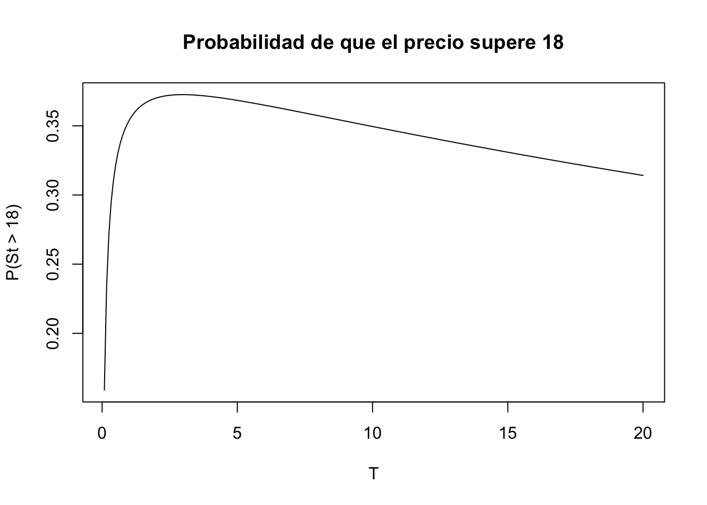

## e)

La probabilidad primero puede subir pero despues vuelve a bajar. No se queda creciendo para siempre.

## f)

No tiene que aumentar siempre. Aqui mu-.5*sigma^2 es negativo entonces el centro de la distribucion del log precio va bajando con el tiempo aunque haya mucha dispersion. Por eso con estos parametros la probabilidad puede subir al principio y despues bajar.

# Problema 10. Reflexión final

## a)

Estimar un modelo es sacar sus parametros con los datos y validar es revisar si lo que supone el modelo en verdad se parece a lo que muestran los datos.

## b)

Lo que si me parece razonable del GBM es que modela el precio como algo aleatorio y que la incertidumbre crece con el tiempo.

## c)

Lo que se ve mas alejado de los datos reales es asumir que los log rendimientos siempre son normales y que la volatilidad es constante porque en los datos se pueden ver colas pesadas y periodos con mas volatilidad.

## d)

Aprendi que la aproximacion con dS puede funcionar bien cuando el tiempo es corto pero conforme aumenta el horizonte se puede alejar mas de la solucion exacta.

## e)

Un modelo puede seguir siendo util aunque no copie perfectamente la realidad porque ayuda a simplificar el problema, hacer simulaciones y medir diferentes escenarios de riesgo.

## f)

**Datos:** uso precios reales para ver como se comporto el activo.

**Parametros:** con los rendimientos estimo mu y sigma.

**Modelo:** uso esos parametros dentro del GBM.

**Simulacion:** genero muchos posibles precios futuros.

**Evaluacion:** comparo lo que genera el modelo con la teoria y con los datos reales para ver que tan bien funciona.
